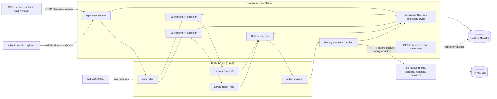

# Architecture

This diagram shows the implemented runtime. Components inside reactive share one JVM; topic nodes represent Kafka topics. The two tariff sources are alternatives selected by configuration.

Compose supplies all three services, Kafka, Kafka UI and the two databases, and uses the dummy tariff source. Micronaut Test Resources supplies missing database/Kafka settings for individual service development and integration tests.

## Connection evidence

- **Tariff HTTP request:** [AgileRatesGateway](../microservices/reactive/src/main/java/uk/ac/york/eng2/reactive/components/agilerates/AgileRatesGateway.java) calls the generated `RatesApi`. [AgileRatesFetcherLogic](../microservices/reactive/src/main/java/uk/ac/york/eng2/reactive/components/agilerates/AgileRatesFetcherLogic.java) saves the snapshot and publishes it. [Application properties](../microservices/reactive/src/main/resources/application.properties) select the external source; [Compose](../microservices/compose.yml) overrides it with local rates.
- **Kafka edges:** [producer interfaces](../microservices/reactive/src/main/java/uk/ac/york/eng2/reactive/kafka) declare the four output topics. [Import](../microservices/reactive/src/main/java/uk/ac/york/eng2/reactive/components/importrate/CurrentImportRateConsumer.java) and [export](../microservices/reactive/src/main/java/uk/ac/york/eng2/reactive/components/exportrate/CurrentExportRateConsumer.java) consumers subscribe to `agile-rates` in separate groups. The [decision consumer](../microservices/reactive/src/main/java/uk/ac/york/eng2/reactive/components/batterydecision/BatteryDecisionConsumer.java) subscribes to both current-rate topics; the [actuator consumer](../microservices/reactive/src/main/java/uk/ac/york/eng2/reactive/components/batteryactuator/BatteryActuatorConsumer.java) subscribes to `battery-decision`.
- **Battery update:** [BatteryActuatorLogic](../microservices/reactive/src/main/java/uk/ac/york/eng2/reactive/components/batteryactuator/BatteryActuatorLogic.java) calls `ActuatorsApi.getActuators` and `updateActuator`. [BatteryDecisionService](../microservices/reactive/src/main/java/uk/ac/york/eng2/reactive/service/BatteryDecisionService.java) defines the thresholds.
- **Reactive persistence:** [services](../microservices/reactive/src/main/java/uk/ac/york/eng2/reactive/service) register components and save typed slot values; [controllers](../microservices/reactive/src/main/java/uk/ac/york/eng2/reactive/controller) query repositories directly. [Migrations](../microservices/reactive/src/main/resources/db/migration) define `component`, `topic_slot`, `configurable` and `last_activated`. The latter two have no corresponding runtime repository/service implementation.
- **IoT persistence:** [controllers](../microservices/iot/src/main/java/uk/ac/york/eng2/iot/resources) use repositories for CRUD and reading queries. [Migrations](../microservices/iot/src/main/resources/db/migration) create/seed tables. Compose supplies a separate datasource for each stateful service.
- **Kafka UI:** its Compose environment points at `kafka-0:9092`.

There is no runtime Kafka edge from IoT. `topic.readings=sensor-readings` is configuration only, and [HeatingSimulation](../microservices/iot/src/main/java/uk/ac/york/eng2/iot/scheduled/HeatingSimulation.java) has no implemented simulation body. There are no physical sensor or battery connections.

## State and processing limits

Typed topic slots store the latest values and support periodic retries when values are missing. Database writes and Kafka publication are separate operations. Import/export values are not correlated to the same update, and stale prices are not rejected. Actuator writes are skipped when the target already matches. These mechanisms demonstrate asynchronous integration, without establishing exactly-once delivery or production fault tolerance.

The [end-to-end tests](../microservices/end2end-tests/src/test/java/uk/ac/york/eng2/integration) run outside application containers, calling IoT/reactive over HTTP. They observe component/slot creation and a battery actuator reaching a valid state. Kafka is exercised indirectly through the running pipeline.
